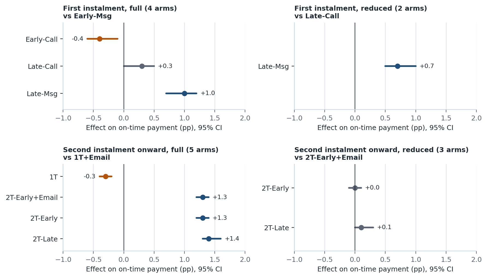
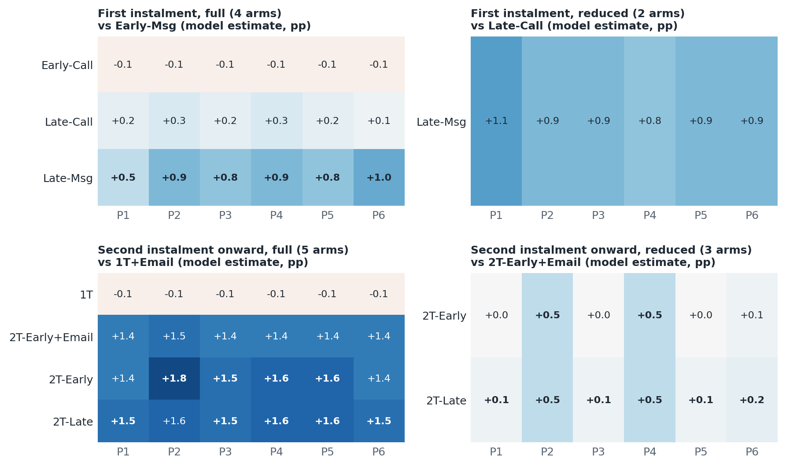
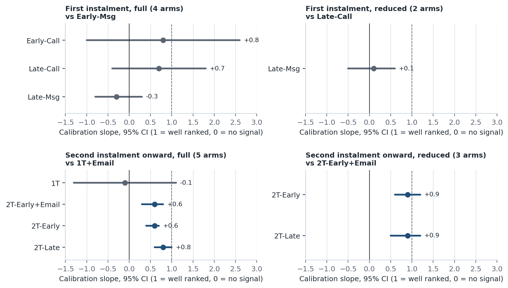

# Payment reminders before the due date: a multi-arm uplift study

> **Real experiment, masked results.** This study was run on real randomized experiments at a consumer
> finance lender. To protect the lender, everything that could identify it or its customers has been
> removed or changed: no company, country, currency, dates, table or column names, customer counts or
> absolute payment rates. Arms, features and products have generic names. Effects are shown in
> percentage points (pp) against the control arm, rounded to 0.1 pp. See [What was masked](#what-was-masked).

## At a glance

A lender sends reminders before each loan instalment falls due. It tested new reminder plans in two
randomized experiments: one for customers facing their **first instalment**, one for customers on their
**second instalment or later**. Each experiment was modelled twice: a **full** version with every arm and a
**reduced** version that keeps only the arms that came out ahead.

This is an exploratory study. The aim is not a targeting model but a clean shortlist for the next pilot:
find the superior treatment, find the segments where it is superior, and remove any treatment that is worse
than another in every segment. The result is 9 plans narrowed to 3 (section 6).

| Experiment | Version | Arms | Control | Best arm | Best arm vs control | Model policy vs best single arm |
|----------------|---------|-----|----------------|----------|------------|--------------|
| First instalment | Full | 4 | Early-Msg | Late-Msg | +1.0 pp | +0.0 pp |
| First instalment | Reduced | 2 | Late-Call | Late-Msg | +0.7 pp | +0.0 pp |
| Second onward | Full | 5 | 1T+Email | 2T-Late | +1.4 pp | -0.1 pp |
| Second onward | Reduced | 3 | 2T-Early+Email | 2T-Late | +0.1 pp | +0.0 pp |

- **First instalment.** Late-Msg is the best arm for every product and every customer group looked at.
  The models find no group for whom another arm would do better.
- **Second instalment onward.** A second reminder is what matters: +1.3 to +1.4 pp over one reminder.
  Email adds nothing once there are two reminders. Among the two-reminder arms, 2T-Late is the safest
  default; 2T-Early matches or beats it for two products but is worse for contracts on the call list.
- **Personalisation adds little here.** In all four versions, a model that picks an arm per customer lands
  within 0.1 pp of giving everyone the best single arm. The value of the models is in describing who
  responds, not in assigning arms.

## 1. Business context

The goal is more instalments paid on or before the due date. Reminders go out through four kinds of
channel: email, app push notification, a chat-app message, and an agent call. The first-instalment
experiment also used a **tracked message**: a two-way message that reports whether it was delivered and
answered, with an agent call the next day only if it was not.

Within each experiment, contracts were assigned to arms at random in equal shares. The difference in
on-time payment rate between two arms is therefore an unbiased estimate of the effect of switching between
them. The uplift models then estimate how that effect varies across customers.

### Arms

**First instalment** (customers with no payment history on the contract). Two schedules crossed with two
ways of making the key contact:

| Arm | Schedule | Key contact |
|---|---|---|
| Early-Msg | Early: first reminder about a week before, key contact a few days before, last reminder two days before | Tracked message, call only if not delivered or answered |
| Early-Call | Early | Direct agent call |
| Late-Msg | Late: first reminder about a week before, key contact two days before, last reminder on the due date | Tracked message, call only if not delivered or answered |
| Late-Call | Late | Direct agent call |

**Second instalment onward** (at least one earlier instalment). No calls; arms vary the number and timing
of push plus chat-app reminders and whether an email is added:

| Arm | Reminders |
|---|---|
| 1T+Email | One reminder the day before the due date, plus email |
| 1T | One reminder the day before |
| 2T-Early+Email | First reminder a few days before, second on the due date, plus email |
| 2T-Early | First reminder a few days before, second on the due date |
| 2T-Late | First reminder two days before, second on the due date |

### Model versions

| Experiment | Version | Arms | Control | Question |
|--------------|---------|-----|----------------|------------------------------------------|
| First instalment | Full | 4 | Early-Msg | Which schedule and which key contact work best? |
| First instalment | Reduced | 2 | Late-Call | Both Late arms beat both Early arms, so Early is dropped. Within Late: tracked message or direct call, and for whom? |
| Second onward | Full | 5 | 1T+Email | How much does a second reminder add, and do timing or email matter? |
| Second onward | Reduced | 3 | 2T-Early+Email | The one-reminder arms are well behind, so they are dropped. Among two-reminder arms: timing and email, and for whom? |

## 2. Data

| Item | Value |
|---|---|
| Unit | One contract instalment, scored before its due date |
| Period | About four weeks of due dates |
| Size | Hundreds of thousands of instalments (first) and a few million (second onward), split equally across arms |
| Target | 1 if the instalment was paid on or before the due date, else 0 |
| Candidate features | About 100: app usage, past repayment behaviour, recent payments, demographics, contract terms, credit bureau |
| Split | 60% train, 40% test, random; the tuner holds out 30% of the train part for validation |

Most instalments are paid on time in both experiments, so effects of around 1 pp are meaningful. Absolute
rates are not published.

## 3. Feature selection

Features are not picked by hand. For each version the tuner tries 20 candidate models (TPE search). Each
candidate draws its own filter thresholds together with the learner type and the gradient boosting
settings, filters the candidate features in three steps, then fits the model:

1. **Missing values.** Drop a feature whose share of missing values is above the threshold (0.1, 0.3 or 0.5).
2. **Near-constant.** Drop a feature whose most common value covers more than the threshold share of rows
   (searched between 0.3 and 0.9).
3. **Correlation.** For each pair of features associated above the threshold (0.3 to 0.9), keep the one
   more strongly associated with the target.

Three features are always kept: product (needed for the product breakdown), instalment amount and the
call-list flag (whether the contract is selected for agent calls). Among candidates whose score is
statistically tied with the best, the one with the fewest features wins.

| Step | First, full | First, reduced | Second, full | Second, reduced |
|---|---|---|---|---|
| Candidate features | about 100 | about 100 | about 100 | about 100 |
| Missing-value threshold chosen | 0.3 | 0.1 | 0.1 | 0.5 |
| Near-constant threshold chosen | 0.39 | 0.30 | 0.31 | 0.34 |
| Correlation threshold chosen | 0.66 | 0.51 | 0.51 | 0.40 |
| Features selected | 6 | 5 | 7 | 6 |

The near-constant thresholds the tuner chose are low (0.30 to 0.39), so this rule removes most features,
including ordinary ones such as gender. The selected lists show the strongest survivors, not every feature
that might matter.

**Selected features.** First instalment: instalment amount, app logins in the last 30 days, age, product,
call-list flag, and in the full version also the time of day of most app logins. Second instalment onward:
instalment amount, worst days late in the last 3 months, amount paid in the last 3 months, age, product,
call-list flag, and in the full version also days late on the previous instalment. Within each experiment
the two versions share the same core; the extra feature in the full version passes its looser thresholds
and fails the reduced version's stricter ones.

## 4. Feature importance

Importance as reported by the chosen model, as a share of the total (sums to 100%). It shows how much the model relies on a feature, not
how large the treatment effect is.

| First, full (S-learner) | % | First, reduced (DR-learner) | % |
|---|---|---|---|
| instalment amount | 28 | instalment amount | 32 |
| app logins, 30 days | 20 | age | 30 |
| age | 19 | product | 18 |
| product | 16 | app logins, 30 days | 12 |
| time of day of app logins | 9 | call-list flag | 8 |
| call-list flag | 8 | | |

| Second, full (DR-learner) | % | Second, reduced (X-learner) | % |
|---|---|---|---|
| worst days late, 3 months | 20 | instalment amount | 30 |
| amount paid, 3 months | 18 | worst days late, 3 months | 25 |
| instalment amount | 16 | amount paid, 3 months | 22 |
| age | 16 | call-list flag | 12 |
| days late on previous instalment | 15 | age | 7 |
| product | 9 | product | 5 |
| call-list flag | 6 | | |

In the second-onward full version, recent repayment history leads. In the reduced version the call-list
flag rises to 12%, matching the split between 2T-Early and 2T-Early+Email seen in section 5.

## 5. Treatment effects

Two kinds of numbers appear below:

- **Observed effects** (Figure 1) are differences in on-time payment rate between randomized arms. They are
  the most reliable numbers in this study.
- **Model effects** (Figure 2 and the text) come from the uplift model as partial dependence: the predicted
  effect when one feature is set to each value, averaged over the test sample. They show where the effect
  is larger or smaller. They are uncalibrated; Figure 3 shows how far to trust them.

### First instalment

Late-Msg is clearly the best arm: +1.0 pp over Early-Msg and +0.7 pp over Late-Call. Late-Call is only
marginally above Early-Msg (+0.3 pp, interval touching zero), and Early-Call is below it (-0.4 pp). Leading
with the tracked message beats a direct call on both schedules, and the late schedule beats the early one
for both kinds of contact.

What the model adds, in the full version:

- Late-Msg's advantage falls with age, from about +1.1 pp for the youngest customers to about +0.6 pp from
  age 40.
- It also falls with app activity: about +0.9 pp for customers with 0 to 2 logins in 30 days, +0.4 pp at
  5 or more. The drop is driven by two products (P1 and P5), where the advantage goes to about zero for
  heavy app users.
- The calibration check (Figure 3) finds no reliable ranking: all slope intervals include zero. Observed
  effects of Late-Msg are positive in every bin of predicted effect.

**Conclusion.** Late-Msg is ahead in every group. Its advantage is largest for younger customers and those
with little app activity, but the calibration check finds no reliable difference between customers, so a
single Late-Msg policy captures essentially all of the gain.

### Second instalment onward

The three two-reminder arms add +1.3 to +1.4 pp over 1T+Email; 1T (one reminder, no email) is -0.3 pp.
Among the two-reminder arms, 2T-Late is +0.1 pp over 2T-Early+Email (interval just above zero), and
2T-Early equals 2T-Early+Email, so email adds nothing once there are two reminders.

What the model adds:

- In the full version, the second reminder helps every group. Its gain is larger for customers who paid
  little in the last 3 months, whose recent payments were late or just on time, and for older customers.
  Calibration slopes are 0.6 to 0.8 with intervals above zero: the model ranks who gains more correctly,
  but its raw predictions are spread wider than the observed effects.
- In the reduced version, the clearest split is the call-list flag: 2T-Early vs 2T-Early+Email is about
  +0.2 pp for contracts not on the call list but about -0.8 pp for those on it. 2T-Late is positive for both.
  Gains over 2T-Early+Email appear mainly for customers with recent lateness. Calibration slopes are about
  0.9, close to 1, so these differences are supported by the data.

**Conclusion.** A second reminder helps every customer group. Between the two-reminder arms the model finds
real but small differences: 2T-Late is the safest default; 2T-Early is as good as or better than 2T-Late for products P2 and P4
and for customers with recent lateness, but worse than 2T-Early+Email for contracts on the call list.

### By product

- **First instalment.** Late-Msg is the best arm for all six products. Against Late-Call its lead is
  largest for P1 (+1.1 pp) and smallest for P4 (+0.8 pp).
- **Second onward.** Every product gains about +1.4 to +1.8 pp from a second reminder. In the reduced
  version, P2 and P4 gain the most from both 2T arms (about +0.5 pp); for the other products 2T-Early adds
  0.0 to 0.1 pp over 2T-Early+Email and 2T-Late adds about +0.1 to +0.2 pp.

These are model estimates. A direct cross-tabulation of payment rate by product and arm should confirm
them before any product-specific rule is adopted.

### Does a personalised policy beat one arm for all?

Policy values are doubly robust estimates on the tuner's validation rows.

| Version | Chosen learner | Model policy minus best single arm | Candidates statistically tied |
|---|---|---|---|
| First, full | S-learner | +0.0 pp | 14 of 20 |
| First, reduced | DR-learner | +0.0 pp | 18 of 20 |
| Second, full | DR-learner | -0.1 pp | 19 of 20 |
| Second, reduced | X-learner | +0.0 pp | 15 of 20 |

No. In every version the model policy is within 0.1 pp of the best single arm, and most candidates are
statistically tied, so the data cannot separate them.

## 6. Which plans stay for the next pilot

A plan is removed when another plan beats it in every segment looked at: every product and every customer
group along each selected feature.

| Experiment | Plan | Evidence across segments | Pilot |
|----------------|----------------|------------------------------------------|----------------|
| First | Early-Call | Below control in every product (about -0.1 pp) | Remove |
| First | Early-Msg | Below both late-schedule plans in every product | Remove |
| First | Late-Call | Below Late-Msg in every product and customer group | Remove |
| First | Late-Msg | Best in every segment; no group where another plan does better | Keep, for all |
| Second onward | 1T | Below 1T+Email in every product | Remove |
| Second onward | 1T+Email | 1.4 to 1.8 pp below every two-reminder plan in every product | Remove |
| Second onward | 2T-Early+Email | Matched or beaten by 2T-Late in almost every segment; never clearly ahead of it | Candidate to remove |
| Second onward | 2T-Early | Ahead for P2 and P4 and for customers with recent lateness; behind for contracts on the call list | Keep, for its segments |
| Second onward | 2T-Late | Positive against 2T-Early+Email for call-list and other contracts and at every age | Keep, default |

The first-instalment pilot needs only Late-Msg. The later-instalment pilot can test 2T-Late as the default
against 2T-Early in the segments where it leads. Whether 2T-Early+Email stays is a judgement call: it is
never clearly ahead of 2T-Late, but the gap is small.

## 7. Lessons

1. **The randomized comparison answers the main question.** Which arm to roll out came from simple
   differences between arms. The uplift models added the "for whom", and here that turned out to be small.
2. **Prune, then refit.** Dropping arms that lose in every segment and refitting asks a sharper question.
   In the second-onward experiment it brought out a real difference (the call-list split) that the full
   version blurred, and it leaves the next pilot with fewer arms and more customers per arm.
3. **Check calibration before trusting heterogeneity.** The first-instalment models draw smooth effect
   curves, but the calibration check shows they cannot rank customers. Without that check the curves
   would look like targeting opportunities.
4. **A personalised policy must beat the best single arm, not only the control.** In three of the four
   versions the model beats the control by 0.7 to 1.4 pp, which sounds like a model win. Against the best single arm the gain is zero.
5. **Watch what the feature filter removes.** Low near-constant thresholds dropped most features. That
   keeps models small, but a reader should not take the selected list as the full set of drivers.
6. **Costs were not in the objective.** The tuner optimised gross on-time payment. Channels differ in cost
   (agent calls cost much more than messages), so a final decision should weigh the gain against cost.

## Appendix A. Tuning setup and chosen models

| Parameter | Search range |
|---|---|
| missing-value threshold | {0.1, 0.3, 0.5} |
| correlation threshold | uniform(0.3, 0.9) |
| near-constant threshold | uniform(0.3, 0.9) |
| learner | {DR, X, S, T} |
| max_depth | log-int(1, 10) |
| num_leaves | log-int(8, 100) |
| learning_rate | log-uniform(0.01, 0.2) |
| min_child_samples | int(30, 200) |
| min_gain_to_split | log-uniform(0.01, 0.2) |

TPE sampler, 20 candidates. Objective: gross doubly robust policy value on the validation rows (cost not
included). Selection: the simplest candidate among those statistically tied with the best. A binned
calibrator (10 bins) is fitted for the policy; the interpretation plots use the uncalibrated model.

| Version | Chosen model |
|---|---|
| First, full | S-learner, max_depth 4, num_leaves 8, learning_rate 0.183, min_child_samples 172, min_gain_to_split 0.019 |
| First, reduced | DR-learner, max_depth 6, num_leaves 11, learning_rate 0.025, min_child_samples 99, min_gain_to_split 0.064 |
| Second, full | DR-learner, max_depth 6, num_leaves 34, learning_rate 0.061, min_child_samples 112, min_gain_to_split 0.010 |
| Second, reduced | X-learner, max_depth 1, num_leaves 44, learning_rate 0.037, min_child_samples 50, min_gain_to_split 0.044 |

The method behind the learners, policy values and calibration is described in [`../method/README.md`](../method/README.md).

## What was masked

| Removed or changed | How |
|---|---|
| Company, country, team, people | Not named. The lender is "a consumer finance lender". |
| Dates and run identifiers | Removed. Only "about four weeks of due dates" remains. |
| Data sources, queries, column names | Removed. Features are described in plain words. |
| Channel and product brand names | Replaced by generic channel types. |
| Arm names | Replaced by descriptive labels (Late-Msg, 2T-Late, ...). Exact day offsets are simplified. |
| Products | Replaced by P1 to P6 in an arbitrary order. Product types are not given. |
| Customer counts | Replaced by orders of magnitude. |
| Absolute payment rates and policy values | Removed. Only differences against a control arm are shown. |
| Effects, intervals, slopes | Rounded to 0.1 pp (or 0.1 for slopes); importances to whole percent. |
| Currency amounts (instalment and payment bands) | Removed; described as low or high. |
| Code, notebooks and data | Not published. The figures here are redrawn from the masked numbers in `masked_results.json`. |
